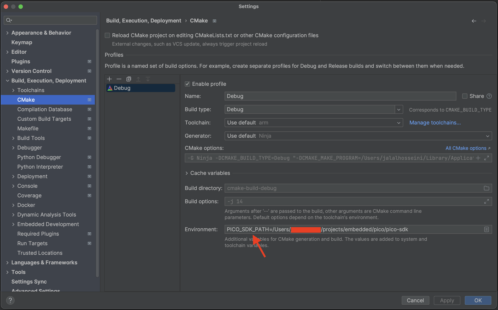
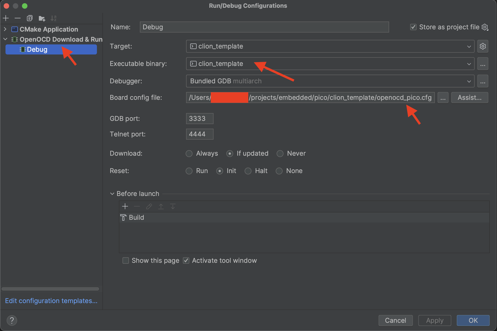
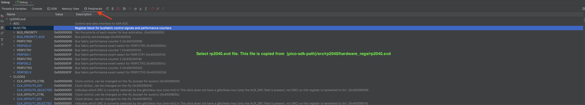
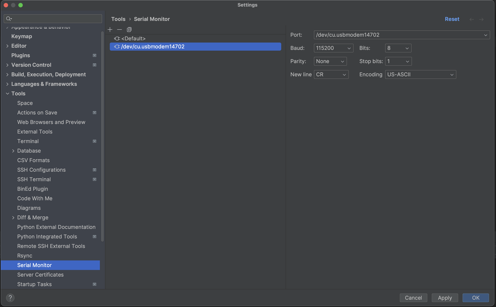
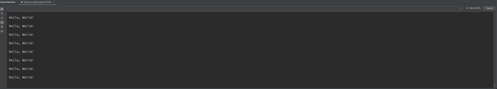

### CLion Raspberry Pi pico template project

Project template for pico board. It uses picoprobe and openocd for debugging.

### Getting started
Follow [pico getting started guide](https://datasheets.raspberrypi.com/pico/getting-started-with-pico.pdf). Appendix A of this 
pdf contains instructions and wiring to get started with picoprobe.

Open this project using CLion. Add an `PICO_SDK_PATH=<path-to-sdk>` to your cmake profile:

Your CLion project is now ready for use. You can build the project and upload the generated file. If you followed the 
picoprobe guide you can start debugging but, first you need to create an openocd config:

#### Debugging

OpenOCD plugin, only accepts one single file. This means we can't add separate files for `board` and `interface` like what you see in the pico documentation.
The solution to this is to create a custom file and then source all required files. `pico.cfg` serves as our config.

`pico.cfg` is pinned by adapter serial to the probe wired to the main Pico, so with the video board's probe also
attached it can never pick that one. It is self-contained, so use it as CLion's board config, with
`scripts/flash.sh`, or as `openocd -f pico.cfg` from anywhere. It is the only OpenOCD config in this repo.

The Pico SDK's `src/rp2350/hardware_regs/RP2350.svd` lets the debugger's Peripherals view show the registers:

To get serial console, you need to first install "Serial Monitor" plugin and then create a new connection:

output:

